# OptiShift-AI 生产环境用户视角验收与深度技术调查综合报告 (单文件归档版)

> **环境配置与测试基线**：
> - **生产环境地址**：[https://optishift-ai-299444-11-1471387898.sh.run.tcloudbase.com/](https://optishift-ai-299444-11-1471387898.sh.run.tcloudbase.com/)
> - **测试基准周次**：2026 年第 41 周（`2026-10-05` 至 `2026-10-11`）
> - **当前生效版本**：正式已确认版本 **v5**（`sch_55898ae95446`）
> - **历史参考版本**：2026 年第 40 周（`2026-09-28` 至 `2026-10-04`）已确认版本 **v4**（`sch_aebfa4f08806`）
> - **在册员工总数**：21 人（含测试账号 `员工AAA` 及 `E01` ~ `E20`）
> - **AI 引擎与模型**：OptiShift Copilot 悬浮窗 / 模型：`gpt-5.6-sol` / 求解器：OR-Tools CP-SAT
> - **文件存放说明**：本文档与报告中展示的所有 31 张测试图片保存在独立的报告专用目录（`report/`），图片链接采用同级相对路径，支持本地或离线完全自包含渲染。原始测试截图存档保留在 `artifacts/acceptance/screenshots/`。

---

# 第一部分：真实浏览器用户视角验收报告 (Real Browser Acceptance Report)

本轮共测试 10 个真实浏览器 Case（含基线检查、核心用例与断流注入）：  
**6 PASS / 3 FAIL / 1 NOT TESTED**

## 1.1 验收结果总览表格

| Case ID | 用户输入 / 动作 | Browser 结果 | Draft 状态 | 正式排班 | 关键现象 | 结论 |
| :--- | :--- | :--- | :--- | :--- | :--- | :--- |
| **BASELINE** | 访问生产 URL 并完成初始化加载 | 页面正常渲染（绕过 CloudBase 3 秒风险拦截），渲染 21 名员工排班网格 | 初始发现残留 v6 草稿，UI 执行清理恢复至纯净正式排班 | v5 已确认 | 右下角 Copilot 正常打开，模型检测正常，工作台无错位 | **PASS** |
| **F01** | `你是谁？` | 明确回答产品身份为 OptiShift AI 智能排班助手，明确不会因纯问答修改正式排班 | 无 Draft | v5 保持不变 | 纯对话无网络错误，未沿用错误上下文，未改动排班 | **PASS** |
| **F02** | `你能干嘛？` | 完整列举排班查询、合规诊断、人力技能分析、方案建议、试排与重排草稿生成能力 | 无 Draft | v5 保持不变 | 聚焦排班产品能力，无通用大模型泛化幻觉，未触发 Mutation | **PASS** |
| **F03** | `你能重新排班吗？` | 明确回复可以重排，但需要用户提供具体的请假/偏好要求，明确本次为能力询问 | 无 Draft | v5 保持不变 | 正确区分“能力询问”与“重排指令”，未调用 Solver，未建 Draft | **PASS** |
| **R01** | `周日为什么安排这么多人？` | 准确读取当前正在展示的 v5 排班，说明周日早晚班各 7 人（最低要求 6 人）及店长资质覆盖，列出具体员工 | 无 Draft | v5 保持不变 | 纯读分析，数据与界面一致，无串台，无 Draft 产生 | **PASS** |
| **R02** | `那周六呢？` | 准确识别为对上一轮“周日”的追问，切换为周六排班分析（早晚班各 6 人，列出在班人员） | 无 Draft | v5 保持不变 | 准确理解代词与上下文，未重复回答周日，未产生 Draft | **PASS** |
| **M01** | `E01 周一请假，帮我按最小改动重新排一下，只生成待确认方案。` | 耗时 15.2s，Solver 判定该约束下严格不可行（缺少周一早班店长），工作台展示 `SCENARIO PREVIEW · 仅供试排`，未生成正式 Draft 方案，且试排态无法退出 | 无 Draft (未生成方案草稿) | v5 保持不变 | 未按用户预期生成待确认 Draft 方案；工作台滞留试排警告条且无任何按钮可清除退出 | **FAIL** |
| **M02** | `E01 周一周二请假，E02 周三晚班优先，帮我重新排一下，只生成待确认方案。`（重复测试 3 次） | 3 次均在执行中崩溃（0/3 PASS）。UI 弹红框 `Agent 操作无效 - 请求未完成，请稍后重试。`，气泡直出 Pydantic 底层校验异常 | 无 Draft | v5 保持不变 | 核心重排阻断。求解不可行后，降级诊断链路因缺少 `shift` 字段触发底层数据结构校验崩溃 | **FAIL** |
| **C01** | `我问一下，你这个周日为什么安排这么多人？`（M02 崩溃后立即追问，重复 3 次） | 正常回答周日早晚班人数与人员清单，业务上零串台（未提及 E01 请假/E02 晚班/重排建议） | 无 Draft | v5 保持不变 | 业务逻辑通过；但工作台主界面仍残留 M01 的试排态面板，上下文未串台但页面状态受污染 | **PASS** |
| **SSE-FI** | 真实浏览器故障注入：在 `/messages/stream` 返回 terminal frame 前主动中断连接 | 前端使用相同 `client_message_id` 向 `/messages` 发起重放恢复，恢复单一气泡与 v6 Draft | 成功生成 1 个 Draft | v5 保持不变 | 断流重放机制有效；但在选择器断言上因 DOM 重名瑕疵导致机器初判偏误 | **PASS** |
| **CLEANUP** | 尝试清理 M01/M02 产生的非正式排班态，恢复纯净正式排班界面 | 工作台持续停留在 `SCENARIO PREVIEW · 仅供试排` 界面，UI 缺乏任何退出/关闭试排态的按钮 | 试排态残留 (无正式 Draft) | v5 保持不变 | UI 只有“取消草稿”按钮，对不可行诊断试排态（`infeasibleResult`）无法清理 | **FAIL** |

---

## 1.2 用例执行图文证据

### 基线与纯对话用例
- **基线检查**：进入页面，排班表完整加载，确认正式排班为 v5，在册员工 21 人。
  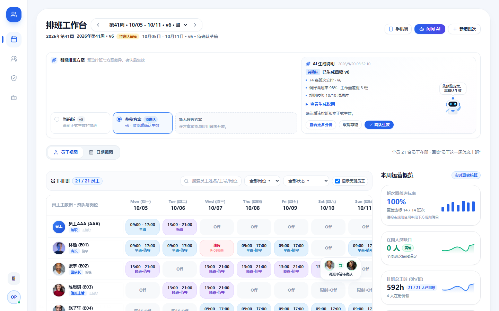
  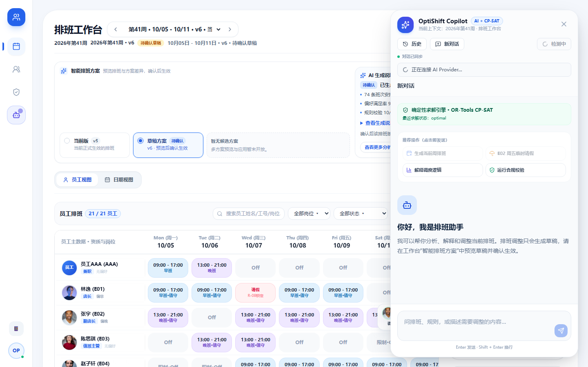
- **Case F01**（你是谁）：AI 回答聚焦 OptiShift 排班助手身份，未生成 Draft。
  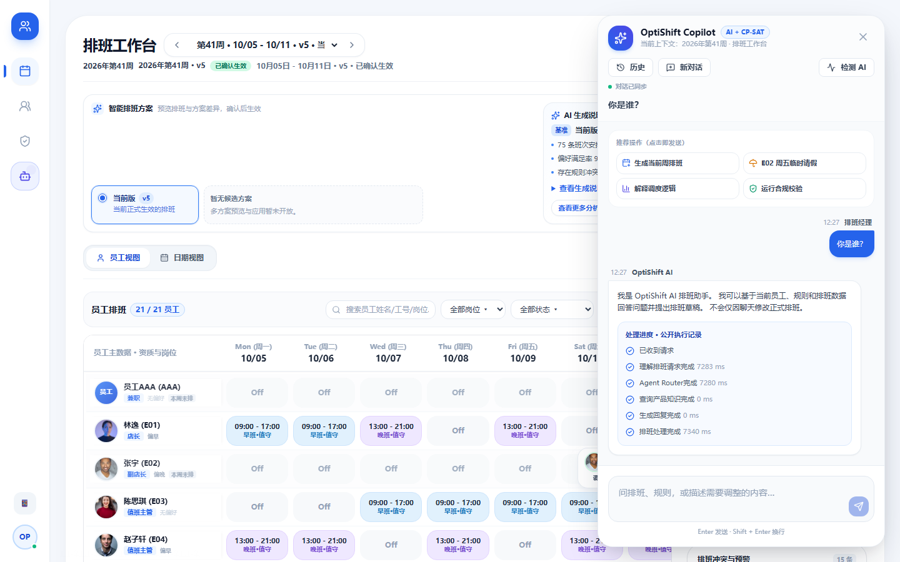
- **Case F02**（你能干嘛）：AI 清晰说明查询、合规、建议、试排与重排能力，未触发操作。
  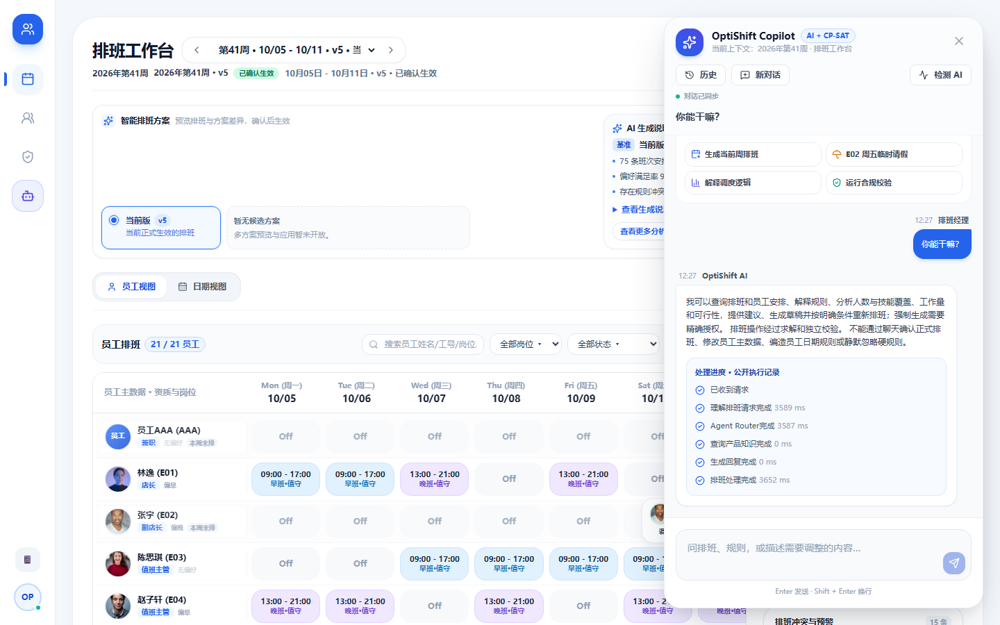
- **Case F03**（你能重新排班吗）：AI 确认可以重排，但要求用户提供具体要求，未误调用 Solver。
  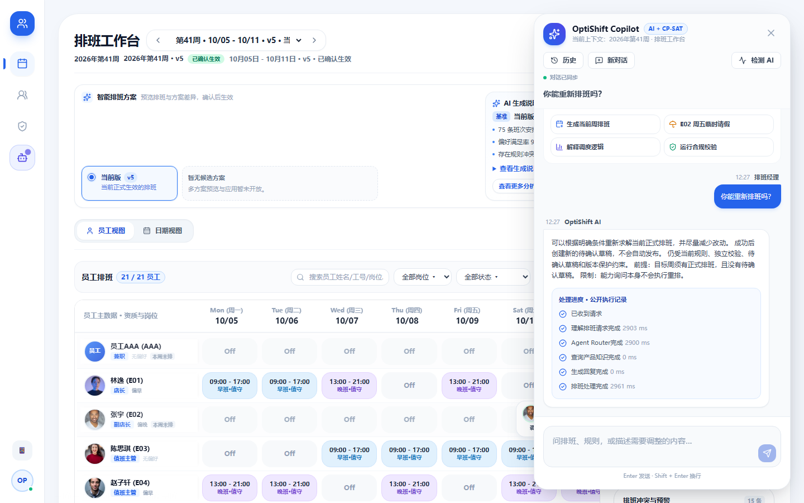

### 只读排班问答用例
- **Case R01**（周日为什么安排这么多人）：准确读取 v5 周日早晚班人数（各 7 人）与技能覆盖。
  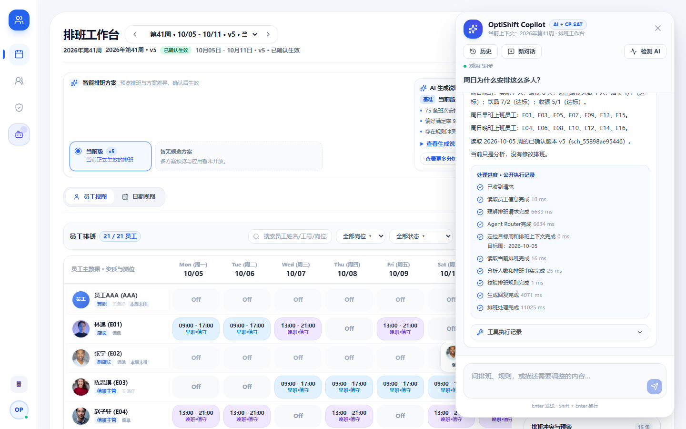
- **Case R02**（那周六呢）：正确识别为周六追问，列出周六早晚班各 6 人在班明细。
  

### 单条件与多条件重排用例
- **Case M01**（E01 周一请假，最小改动）：求解器判定无解，页面展示 `SCENARIO PREVIEW`，未生成正式 Draft。
  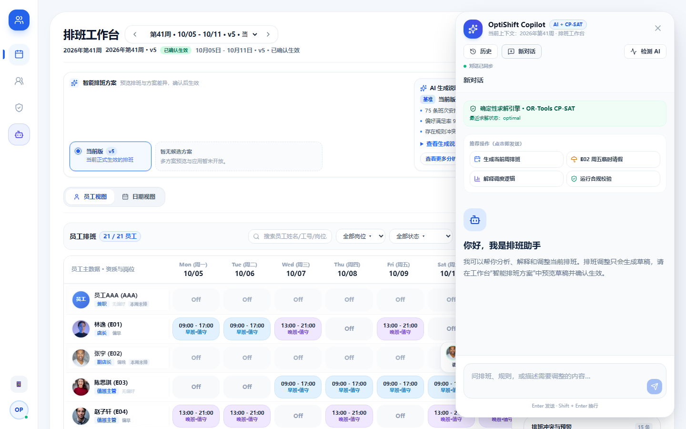
  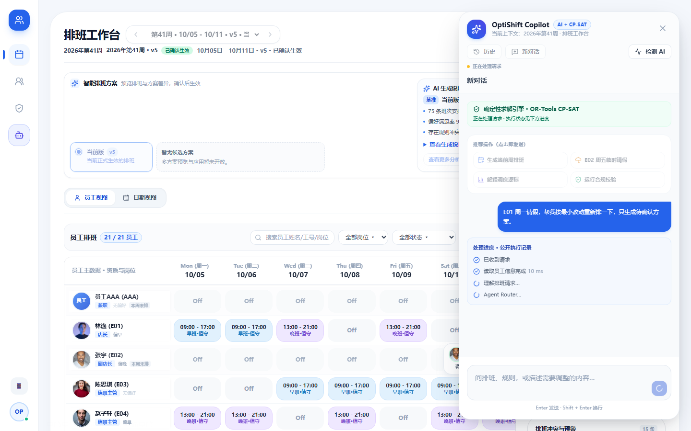
  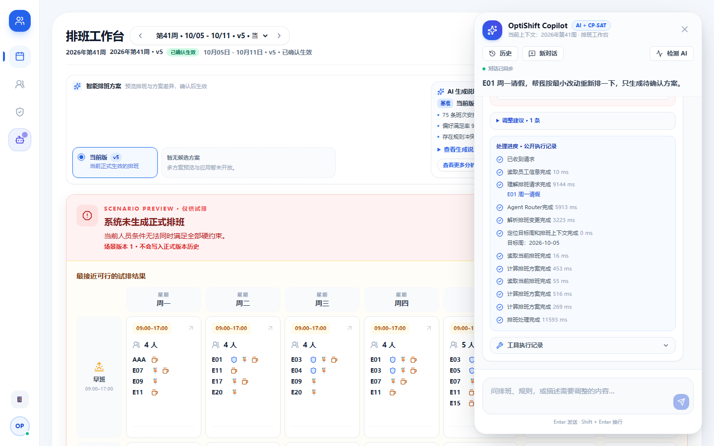
- **Case M02**（E01 周一周二请假，E02 周三晚班优先）：3 次重复测试均因 Pydantic 校验崩溃，前端弹出红色错误框。
  - **Run 1 截图取证**：
    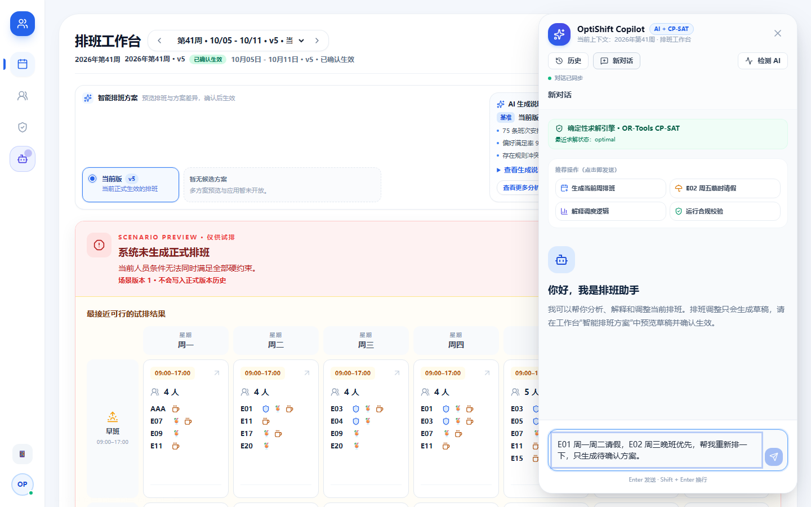
    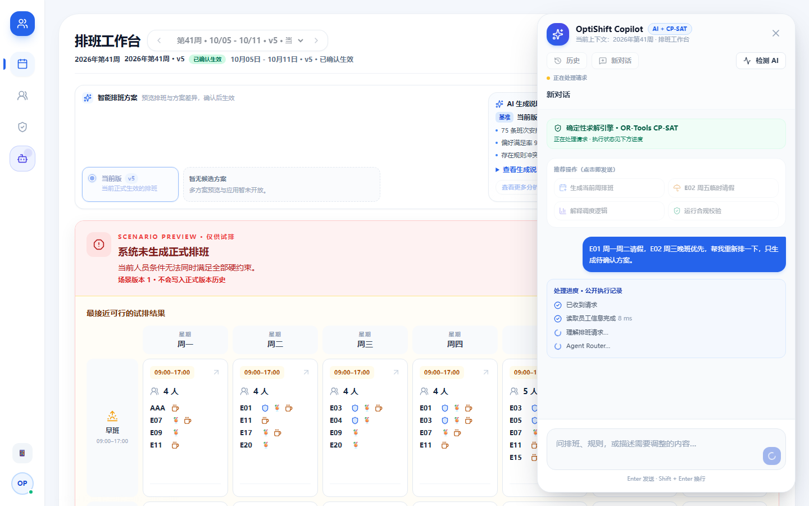
    
    
  - **Run 2 截图取证**：
    
    
    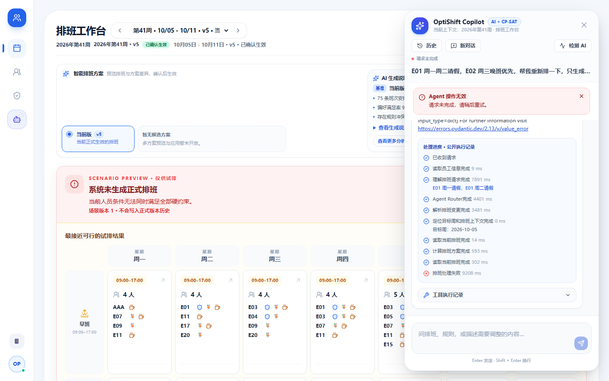
    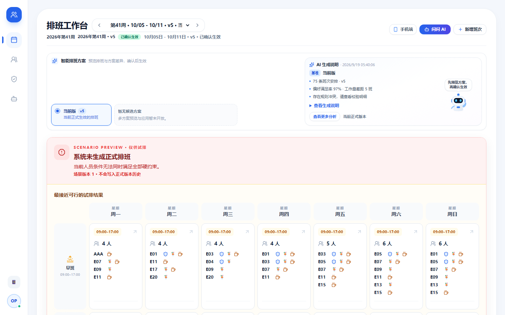
  - **Run 3 截图取证**：
    
    
    
    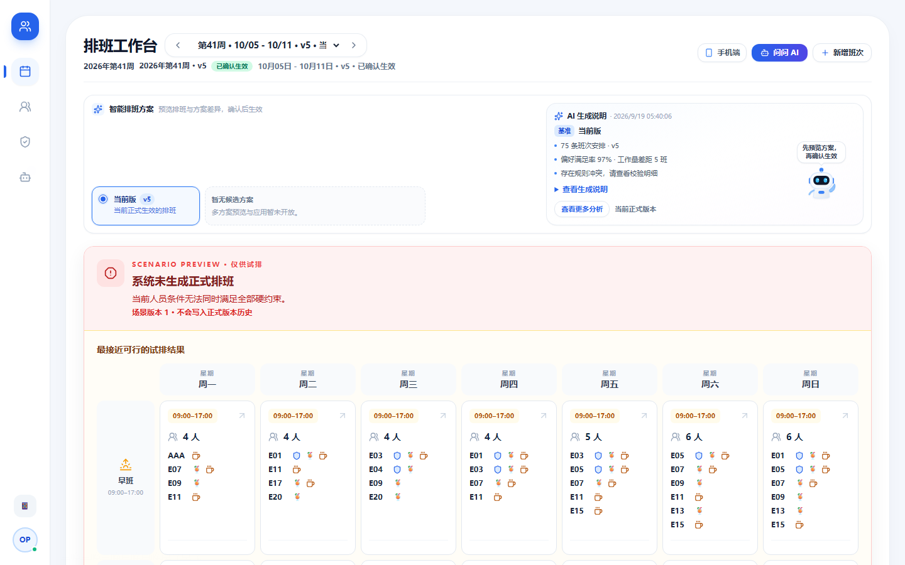
- **Case C01**（串台测试）：M02 失败后立即追问周日排班，模型业务回答正常，但工作台仍残留 M01 的试排态。
  - **Run 1 取证**：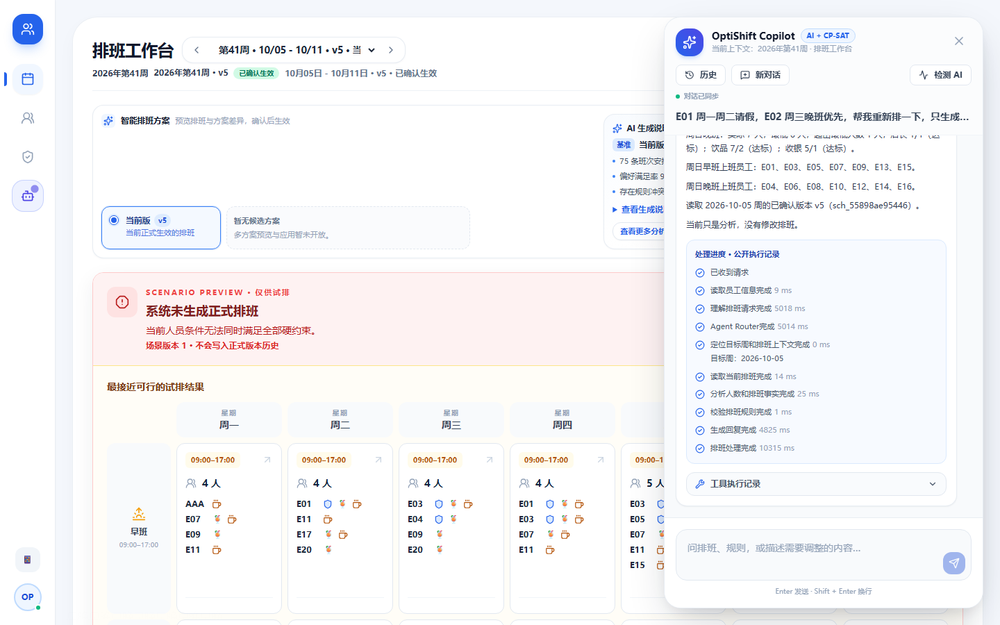
  - **Run 2 取证**：
  - **Run 3 取证**：
- **Case CLEANUP**（试排清理）：尝试返回纯净正式排班，工作台无退出按钮，黄色警告卡片持续残留。
  
- **Case SSE-FI**（断流故障注入）：断开终端帧后成功重放，恢复单一气泡与 Draft。
  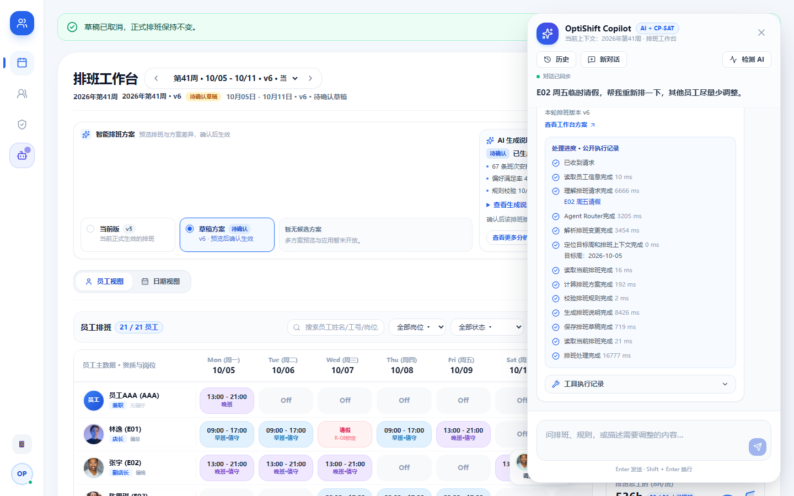

---

## 1.3 缺陷清单 (Bug List)

### 【P0 级 Bug】
#### BUG-01: 包含班次偏好的重排请求在不可行回退诊断时必现 Pydantic 校验崩溃
- **复现步骤**：
  1. 在生产环境打开 AI 聊天框；
  2. 输入：`E01 周一周二请假，E02 周三晚班优先，帮我重新排一下，只生成待确认方案。`；
  3. 发送执行。
- **当前现象**：进度步骤 4 报错卡死，UI 弹出红色错误浮层 `Agent 操作无效 - 请求未完成，请稍后重试。`，聊天气泡直接向用户展示 Python 异常代码 `1 validation error for ScheduleChange Value error, shift is required for change type preference`。
- **预期**：重排不可行时正常进入诊断建议分支，模型正确透传 `shift` 字段，输出合规分析卡片，不发生底层异常崩溃。
- **影响**：所有同时包含“请假”与“班次偏好”（`preference`）或“指定班次”（`assign`）且触发不可行的场景 100% 崩溃，核心排班功能阻断。
- **涉及模块与文件**：
  - `backend/app/models/domain.py:325` (`ScenarioPatch` 缺少 `shift`)
  - `backend/app/services/agent_tools.py:169` (`preview_scenario` 丢失 `shift`)
  - `backend/app/services/scheduling_service.py:195, 239` (还原 `ScheduleChange` 缺少 `shift`)
- **是否稳定复现**：稳定复现（3/3 崩溃）。

---

### 【P1 级 Bug】
#### BUG-02: 腾讯云 CloudBase 默认域名拦截 404 风险提示页
- **复现步骤**：在无 Cookie / 无痕浏览器直接访问生产域名 `https://optishift-ai-299444-11-1471387898.sh.run.tcloudbase.com/`。
- **当前现象**：HTTP 状态码返回 404，页面被腾讯云中间件拦截，出现 3 秒倒计时的安全提醒页，需手动点击“确定访问”才能进入系统。
- **预期**：直接返回 HTTP 200 并渲染排班系统首页。
- **影响**：严重破坏首次访问体验，降低系统可信度。
- **涉及模块**：腾讯云 CloudBase 云托管域名配置（需绑定已备案独立域名）。
- **是否稳定复现**：稳定复现。

#### BUG-03: 后端底层未捕获异常直接泄露至前端气泡
- **复现步骤**：触发任意底层校验或计算异常（如 BUG-01）。
- **当前现象**：聊天气泡直接渲染 Python dict 格式及 `pydantic.dev` 错误链接。
- **预期**：后端全局拦截异常，转换为用户友好的业务提示（如：“排班偏好参数解析异常，请重试”），屏蔽系统内部技术堆栈。
- **涉及模块**：`backend/app/services/agent_service.py` 全局异常捕获机制。
- **是否稳定复现**：稳定复现。

---

### 【P2 级 Bug】
#### BUG-04: 工作台无退出试排态（`ScenarioPreview`）的交互路径
- **复现步骤**：执行 M01 触发试排不可行诊断后，尝试返回原排班表格。
- **当前现象**：由于未生成 Draft，页面无“取消草稿”按钮，工作台持续被 `SCENARIO PREVIEW` 试排黄色面板覆盖，无法通过 UI 退出。
- **预期**：试排警告条右侧提供“退出试排 / 返回当前排班”按钮。
- **涉及模块**：`frontend/src/pages/ScheduleWorkbench.tsx` 与 `frontend/src/store/AppStore.tsx`。
- **是否稳定复现**：稳定复现。

#### BUG-05: 员工列表中混入测试脏数据 `员工AAA (AAA)`
- **当前现象**：排班工作台第一行显示测试员工 `员工AAA (AAA) · 兼职 无偏好`，使在册员工变为 21 人（标准集应为 E01-E20 共 20 人）。
- **预期**：清理测试脏数据，保持基准员工数据集纯净。
- **涉及模块**：生产数据库 `employees` 数据表。
- **是否稳定复现**：稳定复现。

#### BUG-06: Copilot 步骤卡片遗漏多条件摘要展示
- **当前现象**：输入 3 个条件时，进度条“理解排班请求完成”步骤仅显示前 2 个（E01 请假），遗漏了 E02 晚班优先条件。
- **预期**：进度摘要卡片完整展示所有解析出的约束条件。
- **涉及模块**：`backend/app/services/agent_service.py` 进度事件文案拼接。
- **是否稳定复现**：稳定复现。

---

# 第二部分：专项深度技术调查报告 (Deep Technical Investigations)

## 2.1 M01 求解器无解与店长资质数学证明

### 2.1.1 五个核心问题核实结论

1. **严格 Solver 是否确实 infeasible？**
   **确实 100% 数学不可行 (`INFEASIBLE`)**。  
   周一早晚两班共需 2 名店长，全店仅 5 名店长中 4 人被硬约束排除，仅剩 E02 一人；受单人单日最多一班（H01）硬约束限制，1 人无法覆盖 2 个班次（鸽巢原理 $1 < 2$）。
2. **周一早班所有店长候选为何不能排？**
   **5 位店长全部被硬约束阻塞**：
   - **E01**：用户指令请假（R08/leave）。
   - **E02**：若排早班则晚班彻底无店长可用；诊断试排因偏好晚班（S01）将其排入晚班，早班受 H01（已排同日晚班）与 R05（周满 5 班）阻塞。
   - **E03**：第 40 周已连上 5 天（周三至周日），排周一将触发跨周连续工作上限（R06，最多 5 天）。
   - **E04**：主数据周一不可用（R08）且第 40 周周日晚班接周一早班违背休息规则（R07）。
   - **E05**：主数据仅周五至周日可用，周一不可用（R08）。
3. **E02 是否具备资格？为何没排早班？**
   **完全具备资格；因全局店长死结与偏好优化被置于晚班**。  
   E02 资质、可用日、跨周均无障碍。但因全天仅其 1 人可用，早晚必缺其一。严格求解阶段任何安排均无解；诊断试排阶段因 E02 个人偏好晚班（`preferred_shift: evening`，S01 命中奖 +5 分），求解器为最大化目标函数选择保全晚班、暴露早班缺口。
4. **测试预期“必须生成 Draft”是否错误？**
   **完全错误（False Expectation）**。  
   验收脚本 `execute_all_suites.cjs#L203` 将 `hasDraft == true` 设为 PASS 必要条件，脱离了人员资质与跨周约束的联合数学现实。
5. **产品正确行为到底应该是哪一种？**
   **返回无解诊断 + 场景试排（Scenario Preview），绝不生成 Draft**：
   - 拒写脏数据：未通过独立合规校验的排班绝不写入正式排班版本链；
   - 场景试排透明可见：展示缺口诊断并给出严格验证过的修复动作（如“恢复 E01 周一可用”）。

### 2.1.2 候选店长阻塞原因机理图

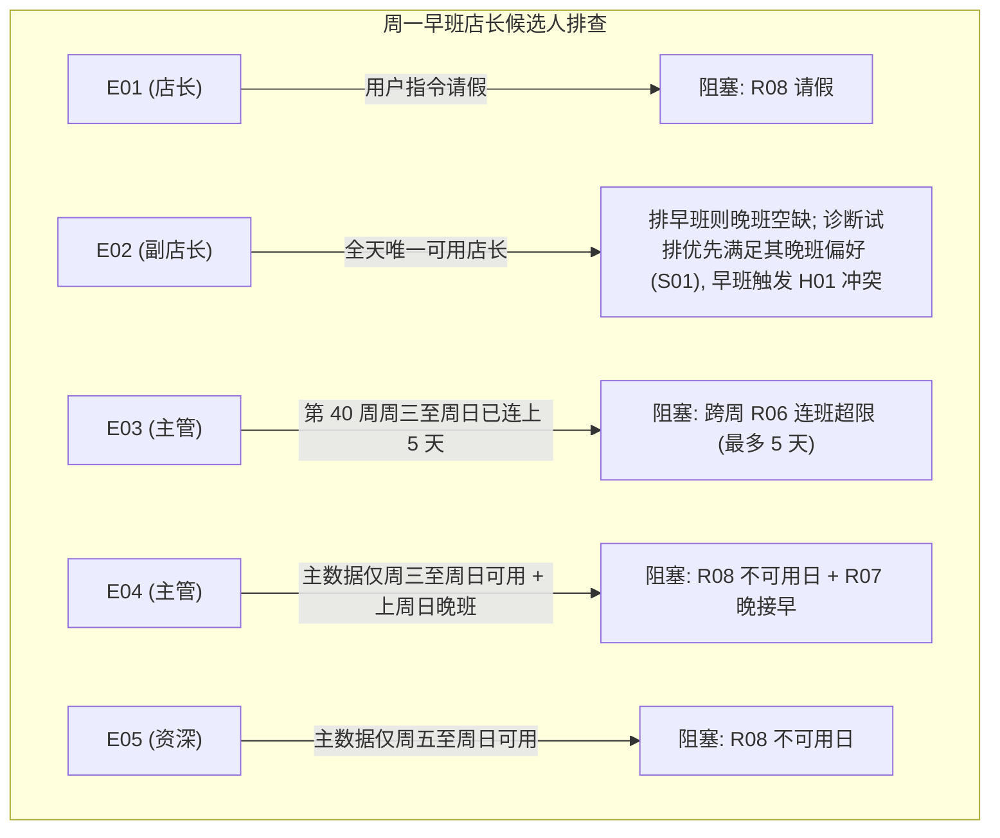

---

## 2.2 M02 的 `shift` 到底在哪一层丢失？

### 2.2.1 八层结构化数据流转追踪

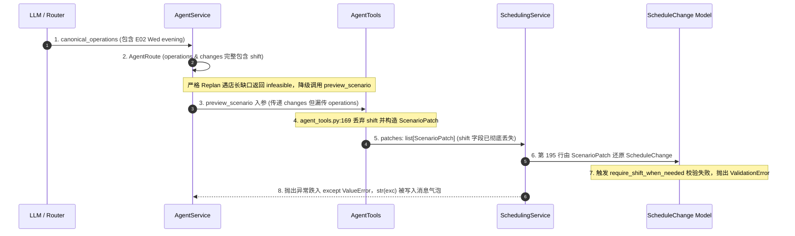

1. **第 1 层：LLM 原始输出 / 确定性提取**
   - 文件：`backend/app/services/agent_router.py:883-911` (`_extract_operations`)
   - 提取结果：
     ```json
     [
       {"operation": "add", "employee_id": "E01", "type": "leave", "day": "Mon", "shift": null},
       {"operation": "add", "employee_id": "E01", "type": "leave", "day": "Tue", "shift": null},
       {"operation": "add", "employee_id": "E02", "type": "preference", "day": "Wed", "shift": "evening"}
     ]
     ```
   - **结论**：**`shift="evening"` 完整保留**。
2. **第 2 层：AgentRoute**
   - 文件：`backend/app/services/agent_router.py:384-391`
   - 属性：`intent="replan"`, `mutation_requested=True`, `target_week="2026-10-05"`。
3. **第 3 层：route.changes**
   - 文件：`backend/app/services/agent_router.py:377-378`
   - 包含：`ScheduleChange(employee_id="E02", type="preference", day="Wed", shift="evening")`，完整保留。
4. **第 4 层：route.operations**
   - 文件：`backend/app/services/agent_router.py:388`
   - 包含：`AgentScenarioOperation(..., shift="evening")`，完整保留。
5. **第 5 层：preview_scenario 入参**
   - 文件：`backend/app/services/agent_service.py:1793-1800`
   - 触发原因：`replan_schedule` 在 Week 41 因 E01 请假返回 `infeasible`，触发第 1782 行兜底诊断调用 `preview_scenario`。
   - 缺陷：参数中只传递了 `changes`，遗漏了传递 `operations`。
6. **第 6 层：ScenarioPatch（首个丢失 shift 的具体位置）**
   - **文件与行号**：[`backend/app/services/agent_tools.py:162-178`](file:///d:/ee/code/OptiShift-AI/backend/app/services/agent_tools.py#L162-L178)
   - 代码：
     ```python
     grouped.setdefault((change.employee_id, change_type), []).append(change.day) # 丢弃 shift
     patches = [
         ScenarioPatch(
             employee_id=employee_id, operation=operation,
             days=list(dict.fromkeys(days)), change_type=change_type,
         ) for (employee_id, change_type), days in grouped.items()
     ]
     ```
   - **模型根因**：[`backend/app/models/domain.py:325-330`](file:///d:/ee/code/OptiShift-AI/backend/app/models/domain.py#L325-L330) 中 `ScenarioPatch` 根本没有定义 `shift` 字段。
7. **第 7 层：ScenarioPatch 转 ScheduleChange 的位置（首个异常抛出点）**
   - **文件与行号**：[`backend/app/services/scheduling_service.py:195`](file:///d:/ee/code/OptiShift-AI/backend/app/services/scheduling_service.py#L195)
   - 代码：`changes.append(ScheduleChange(employee_id=patch.employee_id, type=patch.change_type, day=day))`
   - 触发 `domain.py:166` 校验器抛出 `ValueError("shift is required for change type preference")`。
8. **第 8 层：scheduling_service 候选建议分支（次级隐藏炸弹）**
   - **文件与行号**：[`backend/app/services/scheduling_service.py:239`](file:///d:/ee/code/OptiShift-AI/backend/app/services/scheduling_service.py#L239)
   - 代码：`candidate_changes = [ScheduleChange(employee_id=item.employee_id, type=item.change_type, day=value) for item in candidate_patches for value in item.days]`
   - 在生成 repair 建议时对 candidate_patches 再次抛出完全相同的校验异常。

### 2.2.2 其它业务链路排查与条件覆盖风险
- **其它同类丢字段接口**：
  - 保存试排草稿：`backend/app/services/agent_tools.py:230-234`
  - 可行性分析：`backend/app/services/agent_tools.py:100-101`
  - 强制排班生成：`backend/app/services/agent_tools.py:454-458`
  - 采纳建议重新排班：`backend/app/services/agent_service.py:1444-1450`
- **合并覆盖风险**：
  - `agent_tools.py:162` 仅以 `(employee_id, change_type)` 分组。若用户同时输入“E02 周二早班优先，周三晚班优先”，早班偏好会被晚班吞并覆盖。必须升级分组键为 `(employee_id, change_type, shift)`；
  - `repository/scenarios.py:83-102` 的 `_apply_patch` 仅通过 `change_type` 寻找 `same_type`，会导致不同班次的偏好相互覆盖。必须联合 `item.shift == patch.shift` 判定。

---

## 2.3 修复建议是否会误删其他员工的条件？

### 2.3.1 核心缺陷代码定位
- **定位文件**：[`backend/app/services/scheduling_service.py:227-237`](file:///d:/ee/code/OptiShift-AI/backend/app/services/scheduling_service.py#L227-L237)
- **代码实现**：
```python
227: for patch_index, patch in enumerate(patches):
228:     if patch.change_type.value not in {"leave", "unavailable"} or not patch.days:
229:         continue
230:     for day in patch.days[:2]:
231:         candidate_patches = [
232:             item.model_copy(
233:                 update={"days": [value for value in item.days if value != day]}
234:             )
235:             for item in patches
236:         ]
237:         candidate_patches = [item for item in candidate_patches if item.days]
```

### 2.3.2 4 个关键问题核实结论

1. **是否只移除 E01 周一这一条限制？**
   **否（NO）**。推导式遍历所有 `item in patches`，只要 `value == day`（周一）就剔除，因此**所有员工在周一的条件都被同时移除**。
2. **是否可能把 E02 周一请假也一起移除？**
   **是（YES）**。若场景中存在 `E01 周一请假` 与 `E02 周一请假`，在针对 E01 周一生成修复建议时，E02 的 `days` 也被清空并在第 237 行被当成空项剔除。候选求解器是在**E01 与 E02 周一均上班**的假设下求解的。
3. **candidate_patches 的构造是否按 employee_id 精确匹配？**
   **否（NO）**。代码完全未校验 `item.employee_id == patch.employee_id`，也未校验 `item.change_type == patch.change_type`。
4. **建议文本、实际验证条件、用户点击应用后条件是否一致？**
   **三者严重割裂，构成逻辑欺骗**：
   - **建议文本声明**：`恢复 E01 Mon 可用 —— 移除 E01 在 Mon 的临时限制后，严格 Solver 已验证可以生成完整排班。`
   - **实际验证条件**：后台求解器同时移除了 E01 和 E02 的周一请假；
   - **用户点击应用后**：`scenarios.py#L69-102` 仅按单人移除 E01，E02 的周一请假依然保留。系统再次求解立即报错不可行，直接推翻系统承诺。

### 2.3.3 修复方案对比
```python
# 修复前 (第 231-236 行)
candidate_patches = [
    item.model_copy(update={"days": [value for value in item.days if value != day]})
    for item in patches
]

# 修复后 (精确匹配当前员工与当前类型)
candidate_patches = [
    item.model_copy(update={"days": [value for value in item.days if value != day]})
    if (item.employee_id == patch.employee_id and item.change_type == patch.change_type)
    else item
    for item in patches
]
```

---

## 2.4 Scenario Preview 试排态为什么无法退出？

### 2.4.1 状态流转死锁机制

```text
用户触发不可行试排 (M01/M02)
       │
       ▼
后端返回 status="scenario_preview", strict_feasible=False, draft=None
       │
       ▼
AgentStore.tsx#L255 -> scheduleStore.applyScheduleResult(result)
       │
       ▼
AppStore.tsx#L89-98 -> state.infeasibleResult = action.result
       │               (注意: draftSchedule 为 null)
       ▼
ScheduleWorkbench.tsx#L224 渲染 <ConflictView result={store.infeasibleResult} />
       │
┌──────┴────────────────────────────────────────────────────────────────────────┐
│ 为什么页面死锁，无法返回正式排班？                                             │
│ 1. ConflictView.tsx 为纯展示组件，无关闭 (Dismiss) 按钮；                       │
│ 2. CandidateSummaryPanel.tsx 仅在 isDraft 为真时渲染“取消草稿”，此时为 null；   │
│ 3. AppStore.tsx 根本没有暴露 dismissInfeasibleResult 的 Action；               │
│ 4. 点击“新对话”仅重置了聊天消息，未通知 AppStore 重置 infeasibleResult；       │
│ 5. 页面刷新 (F5) 时，AgentStore#L200-202 还会从历史消息中把不可行结果重新灌入！│
└───────────────────────────────────────────────────────────────────────────────┘
```

### 2.4.2 5 个子问题剖析与交互语义设计

1. **`infeasibleResult` 是否有清除入口？**
   **没有**。`AppStore.tsx` 仅提供了 `dismissError`、`dismissNotice`，完全未提供针对 `infeasibleResult` 的清除入口。
2. **`ScenarioPreview` 是否有独立的退出动作？**
   **没有**。“取消草稿”依赖 `draftSchedule != null`，试排态下该按钮不渲染。
3. **“返回当前排班”和“放弃本次场景条件”是否应该是两个不同动作？**
   **必须解耦为两个动作**：
   - **动作 A：返回当前排班（View-Level Dismiss）**：前端执行 `dismissInfeasibleResult()`，隐藏警告条并高亮正式排班 v5 网格，不删除后端的场景补丁，用户可在 Copilot 中继续追加讨论；
   - **动作 B：放弃本次场景条件（Data-Level Reset）**：前端调用后端 `DELETE /api/agent/conversations/{id}/scenario` 清空会话补丁，彻底恢复纯净状态。
4. **点击“新对话”后，旧 conversation 的 scenario state 是否仍然作用于页面？**
   **是的**。`AgentStore.newConversation` 仅重置了聊天消息数组，未联动重置 `scheduleStore.infeasibleResult`，旧诊断横幅跨对话死锁。
5. **退出后，下一次聊天是否还会继承 E01 请假条件？**
   - 若开启“新对话”：后端以新 `conversation_id` 隔离，后端不继承；但前端视图由于状态污染仍显示旧横幅；
   - 若在同对话中继续输入：后端 `scenarios.py:97` 会累加继承历史补丁；
   - 若按 F5 刷新：前端 `latestInfeasibleMutation` 会从历史消息中再次灌入不可行状态。

---

## 2.5 E02 周五测试：“排班已生成”但页面仍在加载的根因

**截图定位**：`E02-FRIDAY-TEST.png`（Copilot 显示“已生成 v6 草稿”，工作台显示“正在读取方案……”，排班区空白，左上角显示“· 未生成”）。

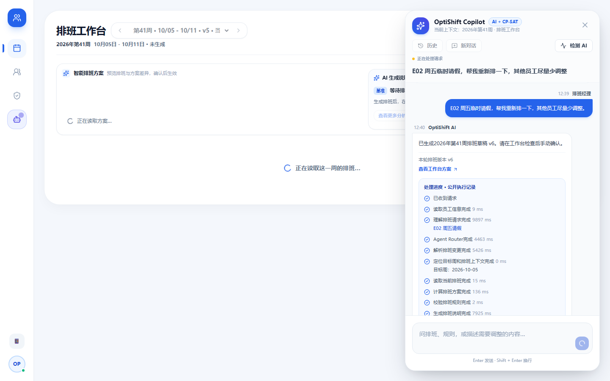

### 2.5.1 定性结论与时序分析
**判定结果：属于 A（截图发生在正常异步刷新期间）与 B（草稿已写入，但前端 weekContext/validate 请求正在飞行中）的复合现象。不存在 C（竞态问题）或 D（永久 loading）。**

- **网络时序全流程**：
  ```text
  [t=00.00s] 用户发送："E02 周五临时请假，帮我重新排一下，其他员工尽量少调整。"
  [t=09.58s] SSE 连接建立，后端求解排班完成并写入数据库草稿 v6 (耗时 12.6s)
  [t=22.22s] AgentStore 收到完整结果：
             1. 同步执行 setMessages：右侧 Copilot 气泡瞬间渲染 "已生成 v6 草稿"
             2. 异步调用 scheduleStore.applyScheduleResult -> loadWeek(weekStart)
             3. AppStore 触发 isLoadingWeek=true，并将 confirmedSchedule/draftSchedule 临时置 null
                - 方案选择区显示：正在读取方案…
                - 排班表格区显示：正在读取这一周的排班…
                - 页面子标题由于 activeSchedule 为 null，视觉回退为 "· 未生成"
  [t=22.30s] GET /api/schedules/week-context 返回 200 OK (70ms)
  [t=22.41s] POST /api/schedule/validate 返回 200 OK (113ms)
  [t=22.45s] isLoadingWeek 置为 false，工作台完整渲染 v6 草稿，界面加载恢复正常
  ```
- **36 秒完整实测核验**：
  1. 最终 DOM 正确渲染 v6 草稿，张宇（E02）周五显示 `Off`，操作区提供“取消草稿”与“确认生效”；
  2. `/api/schedules/week-context` 在 22.3s 正常返回，`draft_schedule.version === 6`；
  3. `isLoadingWeek` 最终为 `false`；
  4. 刷新页面（F5）后 v6 草稿稳定存在；
  5. 异常路径也有 `finally: isLoadingWeek=false` 兜底，**不存在永久 loading**。

  - **过程取证（20秒过渡态）**：
    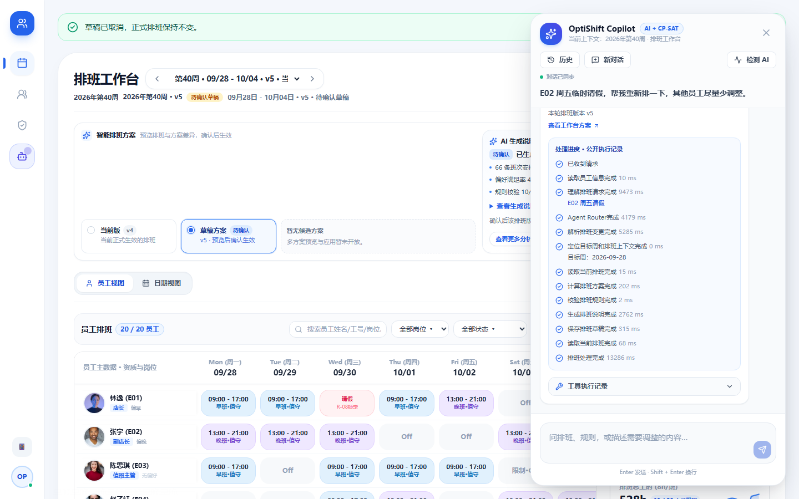
  - **最终完成态（v6 草稿正常渲染就绪）**：
    
  - **页面刷新持久化复核（F5 刷新后草稿依然完好）**：
    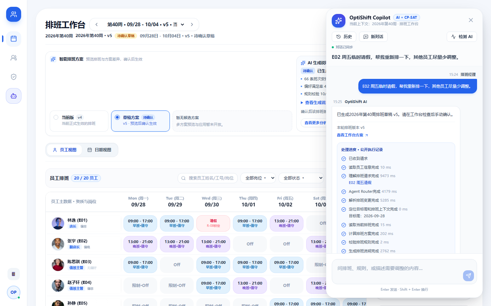

---

## 2.6 SSE 故障注入测试真实结果复核

### 2.6.1 逐项回答与技术定性

1. **为什么 testPassed 是 false？**
   - 脚本断言为：`const testPassed = terminalDropped && replayTriggered && sameIdUsed && (bubbleCount >= 1) && (draftCardCount === 1);`
   - 脚本使用了过宽的选择器 `page.locator('text=草稿方案').count()`，在页面中匹配到了 **2** 个元素，导致 `draftCardCount === 1` 判定为 `false`。
2. **`draftCardCount=2` 是两个 UI 卡片还是两个真实 Draft？**
   **不是两个真实 Draft，也不是两个选择卡片！** 它是：
   - 元素 1（方案选择卡片）：`CandidatePlanCard.tsx#L20` 中的 `<span ...>草稿方案</span>`；
   - 元素 2（方案对比栏列头）：`CandidateComparisonBar.tsx#L12` 中的 `<h4 ...>草稿方案</h4>`。
3. **两个卡片的 `schedule_id`、`version`、`client_message_id` 是否相同？**
   **完全相同**。两个 DOM 节点渲染自同一个 `store.draftSchedule` 对象，幂等重放使用的也是同一个 `client_message_id`。
4. **数据库中是否真的写入了两次草稿？**
   **绝对没有**。
   - 机制 1：`schedules.py:326` 在写入前执行 `_current_draft_record(lock=True)`，同周存在草稿直接抛出 `DraftPendingError`；
   - 机制 2：`agent_service.py:1252` 收到重放请求时通过 `get_idempotent_turn_result` 直接读取缓存响应，未再次访问求解器或数据库。
5. **断流后重放是否只产生一个 assistant 气泡？**
   **是，严格只有 1 个气泡（`bubbleCount: 1`）**。前端通过 `settledMessageIdsRef` 与消息去重机制保证只追加一次。
6. **最终验收标准应该以哪个字段判断通过？**
   应联合断言：
   `terminalDropped && replayTriggered && sameIdUsed && (bubbleCount === 1) && (await page.locator('#schedule-plans button[aria-pressed]:has-text("草稿方案")').count() === 1)`。

---

## 2.7 C01 上下文串台测试假阳性根因分析

**追问原句**：`我问一下，你这个周日为什么安排这么多人？`

### 2.7.1 判定代码与真实回复对照

- **测试脚本判定逻辑**（`execute_all_suites.cjs:314-319`）：
  ```javascript
  const c01HasCrosstalk = (
    c01.assistantText.includes('E01') ||
    c01.assistantText.includes('请假') ||
    c01.assistantText.includes('E02') ||
    c01.assistantText.includes('晚班优先')
  );
  ```
- **助手真实完整回复**：
  > 周日早班：实际 7 人，最低 6 人，超出最低人数 1 人；店长 3/1（达标）；饮品 6/2（达标）；收银 5/1（达标）。  
  > 周日晚班：实际 7 人，最低 6 人，超出最低人数 1 人；店长 1/1（达标）；饮品 7/2（达标）；收银 5/1（达标）。  
  > **周日早班上班员工：E01、E03、E05、E07、E09、E13、E15。**  
  > 周日晚班上班员工：E04、E06、E08、E10、E12、E14、E16。  
  > 读取 2026-10-05 周的已确认版本 v5（sch_55898ae95446）。当前只是分析，没有修改排班。

### 2.7.2 误判与状态污染深度剖析

| 检查维度 | 实测结论 | 深度技术细节 |
| :--- | :--- | :--- |
| **它具体匹配到了什么？** | 命中了字符串 **`'E01'`** | E01（林逸，店长）在第 41 周正式排班周日早班**本来就是正常上班人员**。模型据实列出上班员工花名册，被测试断言粗暴误杀。 |
| **模型回复是否串台？** | **零业务串台** | 未包含“请假”、“晚班优先”或重排建议，准确识别为只读分析（`intent: advice / query`）。 |
| **测试脚本是否因横幅误判？** | **否** | 脚本只读取了聊天气泡文本，未检查左侧工作台。 |
| **归类为业务串台还是 UI 污染？** | **严格归类为 UI 状态污染** | 因 C01 为只读分析，后端返回 `schedule_result: null`。前端 `AgentStore.tsx#L250-258` 在无结果且同周时跳过了 Store 更新，导致 M01 留下的 `infeasibleResult` 试排横幅留在工作台。这是**前端 Store 派生状态未及时清理导致的 UI 状态污染**。 |

---

## 2.8 Pydantic 内部错误为什么能直接进入聊天气泡？

### 2.8.1 异常穿透全链路

```text
1. [domain.py:166] ScheduleChange 抛出 ValueError("shift is required for change type preference")
   Pydantic 封装为 ValidationError (继承自 ValueError)
       │
       ▼
2. [scheduling_service.py:195] 未捕获向外抛出
       │
       ▼
3. [agent_service.py:1992] except ValueError as exc:
   误将 ValidationError 判定为业务说明，调用 self._complete_failure(message=str(exc))
       │
       ├──> 将 str(exc) (包含 pydantic.dev 链接) 存入数据库 ConversationMessageRecord.content
       └──> 抛出 AgentTurnError(422, "invalid_agent_action", str(exc), ...)
       ▼
4. [网络传输层] api/agent.py (SSE) 或 main.py (HTTP) 将 str(exc) 原样下发给前端
       │
       ▼
5. [前端 AgentStore.tsx:289-299] catch (error) 通过 persistedTurn 恢复 assistant 气泡
   -> 用户在聊天界面直接看到 Python Pydantic 校验错误明文！
```

### 2.8.2 四类错误区分机制与修复后固定文案

1. **用户输入错误（模糊/缺项）**：
   - 规范：属于正常对话，`AgentRouter` 返回 `intent: clarification`，HTTP 200，气泡显示引导提问；
2. **AI / 路由服务故障**：
   - 规范：降级规则；若降级失败抛出 `AIUnavailableError`，统一 HTTP 503，文案：`"AI 辅助服务当前响应异常，请稍后重试。"`；
3. **排班求解无解（Solver Infeasible）**：
   - 规范：属于正常分析输出，HTTP 200，文案：`"场景试排仍不可行（场景版本 1）。我已返回最接近可行的试排结果和覆盖缺口，正式排班未改变。"`，附带结构化缺口卡片；
4. **系统内部代码异常（Internal Error）**：
   - 规范：记录全量堆栈 `logger.exception`，阻断敏感信息存入数据库，HTTP 500，统一固定文案：`"排班服务处理异常，请稍后重试或调整排班条件。"`。

### 2.8.3 统一错误码体系设计

| 统一错误码 (`code`) | HTTP 状态 | 日志级别 | 用户看到脱敏文案 | 典型场景 |
| :--- | :--- | :--- | :--- | :--- |
| `clarification_required` | 200 | `info` | 动态澄清提示（如“请说明具体日期班次”） | 缺少班次、员工指代模糊 |
| `entity_not_found` | 404 | `warning` | `员工主数据中不存在：{ids}。` | 提及未录入的员工工号 |
| `draft_pending` | 409 | `info` | `当前周已有待确认草稿，请先确认或取消当前草稿。` | 存在未处理草稿时请求重排 |
| `version_conflict` | 409 | `warning` | `正式排班版本已变化，请刷新后重试。` | 并发操作版本已被更新 |
| `suggestion_stale` | 409 | `info` | `该建议所依据的排班或场景条件已变化，请重新获取建议。` | 点击已过期的建议卡片 |
| `ai_unavailable` | 503 | `warning` | `AI 辅助服务当前响应异常，请稍后重试。` | 大模型 API 超时、限流、网络故障 |
| `agent_internal_error` | 500 | **`exception` (保留全量堆栈)** | `排班服务处理异常，请稍后重试或调整排班条件。` | Pydantic 校验、代码 Bug、数据库异常 |

---

# 第三部分：下一轮代码修复优先级与执行路线图

根据上述两阶段技术调查的实证结论，为下一轮开发治理提供明确的修改清单：

1. **P0 紧急缺陷（核心排班阻断与算法漏洞）**：
   - **`domain.py:325`**：在 `ScenarioPatch` 补充 `shift: Shift | None = None`；
   - **`agent_tools.py:155-178`**：保留 `shift` 传递，并将分组键升级为 `(employee_id, change_type, shift)`；
   - **`scheduling_service.py:195, 239`**：还原 `ScheduleChange` 时补充传入 `shift` 参数；
   - **`scheduling_service.py:231-236`**：候选建议推导必须加上 `item.employee_id == patch.employee_id and item.change_type == patch.change_type` 精确匹配；
   - **`agent_service.py:1992`**：增加 `except ValidationError:` 拦截，记录 `logger.exception` 并向前端返回固定脱敏提示，杜绝直接暴露堆栈。
2. **P1 交互死锁与状态污染缺陷**：
   - **`AppStore.tsx`**：增加 `dismissInfeasibleResult()` Action；
   - **`ConflictView.tsx`**：在卡片中提供“返回正式排班”（UI 退出）与“清空试排条件”（数据重置）按钮；
   - **`AgentStore.tsx:250-258`**：在接收到只读问答或开启新会话时，主动清理旧试排状态；
   - **腾讯云域名**：绑定已备案独立域名，消除 CloudBase 默认域名的 404 风险提示页。
3. **P2 测试套件断言加固**：
   - **`execute_all_suites.cjs`**：将 M01 的断言调整为适应物理无解情况；将 C01 的 `hasCrosstalk` 正则修正为检查业务意图，杜绝将正常员工工号误判为串台；
   - **`test_sse_fault_injection.cjs`**：将方案卡片选择器精确限制在 `#schedule-plans button[aria-pressed]:has-text("草稿方案")`；
   - **数据库清理**：从生产 MySQL 中删除测试脏数据 `员工AAA`。
